<p align="center">
  <picture>
    <source media="(prefers-color-scheme: dark)" srcset="docs/images/logo-dark.png">
    
  </picture>
</p>

<h1 align="center">ZeeBoard</h1>

<p align="center">
  A desktop app to run your <b>art commissions</b>: requests, clients, characters, work stages, progress images, payments and deadlines, all in one board that lives on your computer.
</p>

<p align="center">
  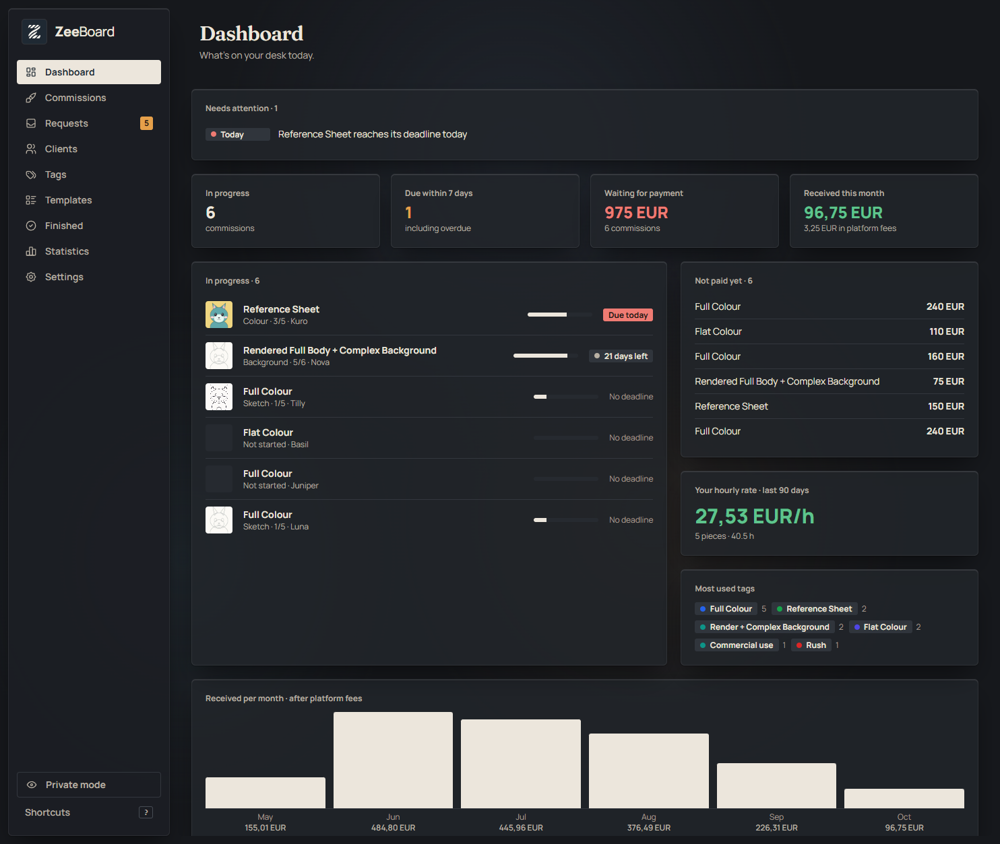
</p>

> Every screenshot in this document uses invented demo data (made-up clients, prices and artwork).

ZeeBoard is made for artists who work on commission and want every job organized without depending on a cloud service. It is **local-first**: your database and images stay on your machine, and the app only talks to the internet for one optional thing (profile photos, see [Privacy and data](#privacy-and-data)).

It works in **English and Spanish**, in light, dark or system theme, and it is built around the way a commission actually flows: someone asks, you accept, you draw it in stages, the client reviews each stage, they pay, you deliver.

## Contents

- [Install](#install)
- [A commission from start to finish](#a-commission-from-start-to-finish)
- [Dashboard](#dashboard)
- [Commissions](#commissions)
  - [Inbox, list and grid](#inbox-list-and-grid)
  - [Stages and images](#stages-and-images)
  - [Corrections and revisions](#corrections-and-revisions)
  - [Creating and editing a commission](#creating-and-editing-a-commission)
  - [Invoice description](#invoice-description)
- [Payments](#payments)
- [Requests](#requests)
- [Clients and characters](#clients-and-characters)
- [Catalog: types and tags](#catalog-types-and-tags)
- [Finished commissions](#finished-commissions)
- [Statistics](#statistics)
- [Trash and undo](#trash-and-undo)
- [Reminders](#reminders)
- [Importing PayPal payments](#importing-paypal-payments)
- [Search and shortcuts](#search-and-shortcuts)
- [Private mode](#private-mode)
- [Receiving images from the iPad](#receiving-images-from-the-ipad)
- [Settings](#settings)
  - [Backups](#backups)
  - [Exporting data](#exporting-data)
- [Themes and languages](#themes-and-languages)
- [Privacy and data](#privacy-and-data)
- [For developers](#for-developers)
- [Roadmap](#roadmap)
- [License](#license)

## Install

1. Download the installer (`ZeeBoard_x.y.z_x64-setup.exe`) and run it. The setup lets you pick English or Spanish.
2. Windows may warn that the app is unsigned. Choose **More info → Run anyway**.
3. Open **ZeeBoard** from the Start menu.

Updating is the same: run the new installer over the old one. Your data is kept (it lives outside the install folder).

Moving to another computer: on the old one use **Settings → Backups → Export**, on the new one use **Restore** and pick that folder. See [Backups](#backups).

## A commission from start to finish

1. A person fills in your form (or you add them by hand) and appears in **Requests**.
2. You **accept** them: ZeeBoard creates the client, the commission, the price and the tags for you.
3. The commission starts in the **queue** and moves through the stages of its **template** (sketch, lineart, colour, delivery…).
4. At each stage you add images, and the client's corrections are logged as revisions.
5. Payments are logged as they arrive, with the platform fee already worked out.
6. You **mark it as finished** (delivery date, hours spent, a final image and notes) and it goes to the archive, where your income and your rate per hour are worked out.

Along the way, **reminders** warn you about deadlines, stalled work and unpaid commissions, and the **dashboard** shows what needs your attention today.

## Dashboard

What is on your desk today, at a glance.


- **Today**: what needs attention, with the reason next to each item: past its limit, due today or soon, stalled, or past the sketch without any payment.
- **In progress**: every open commission with the colour bar of its type, its current stage, a thin progress bar and its deadline. Click one to open it.
- **Received per month**: a line chart of the money that actually reached you (net of platform fees, by payment date). The last point is the month still running, drawn dashed.
- **This month** (right column): what you received (with the platform fees), what is waiting for payment, how many are in progress and how many are due within 7 days (overdue included).
- **Not paid yet**: what each commission still owes. Below it, **your hourly rate** over the last 90 days (what you kept after fees divided by the hours of the commissions you finished) and your **most used types and tags**.

## Commissions

### Inbox, list and grid

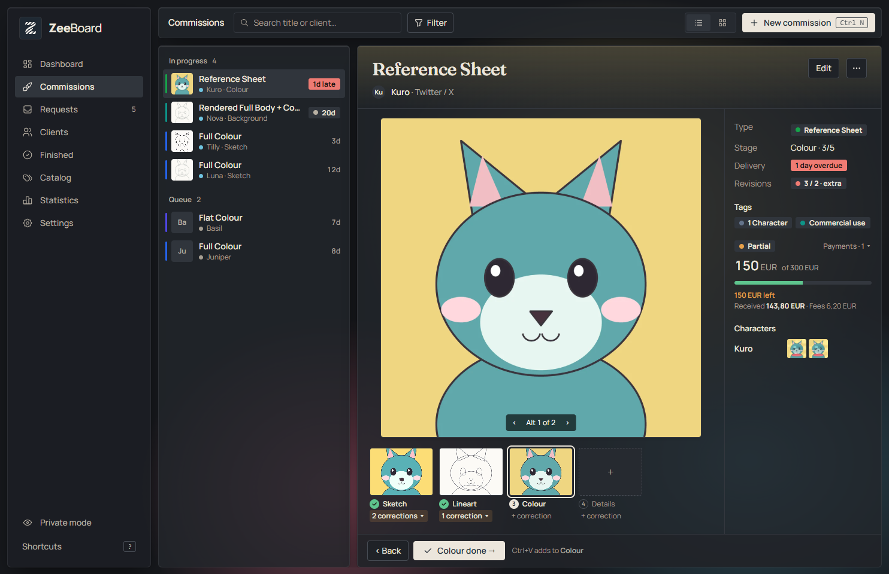

- The left column is your **inbox**: commissions already in a stage, then the **queue** of those not started. Each row has a **colour bar** (the colour of its type, set in the [Catalog](#catalog-types-and-tags)), a thumbnail (or the client's initials), the stage and the days left (or the days since you accepted it when there is no deadline).
- On top: a **search box** (title or client) and a single **Filter** button with payment, status, type and tags inside. What you pick shows next to it as chips you remove with ✕, plus **Clear filters**.
- The detail has a **header tinted with the colours of the image you are looking at** (it changes with a fade), with the title, client and platform, **Edit** and a **···** menu. The column on the right shows the type, stage, deadline, a **revisions counter**, the tags, the payments, the notes and the characters, and a button that copies the client's **tag account** (to paste when you post).

**Grid view** shows every commission as a card, with a **calendar** of your deadlines and a summary of the next one.

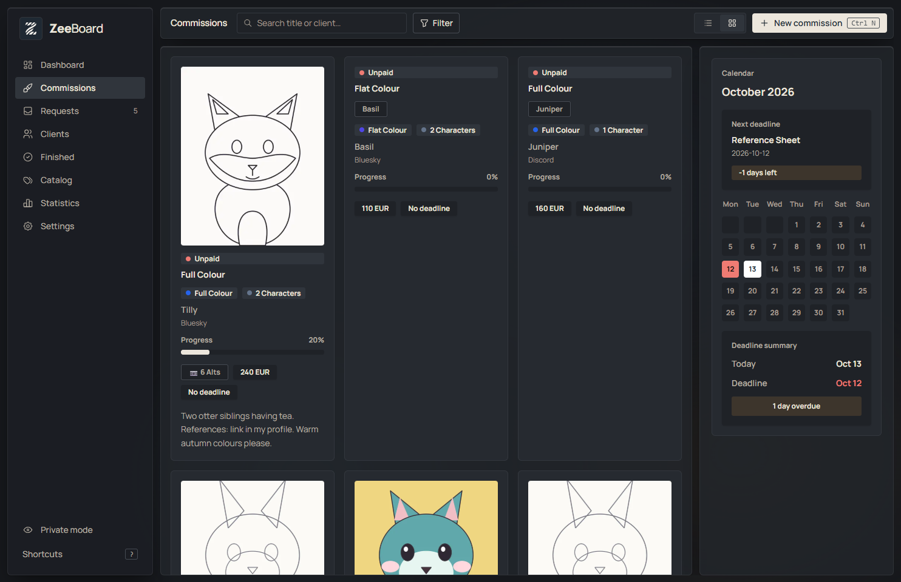

The **···** menu on a commission lets you **duplicate** it, **copy the invoice description** or **delete** it.

### Stages and images

The image of the stage you pick is shown **large**, with its alternatives, and below it a **numbered strip of stages** (thumbnail, a ✓ once done). Click a stage to see its image; the current one is selected by default.

- Add images by **dragging them in**, pasting with **Ctrl+V** (they go to the current stage) or clicking the empty slot. The app resizes and compresses them in the background, so even a 60 MB canvas is fine.
- A stage can hold several **alternatives** (**Alt 1**, **Alt 2**…): the options you show the client, for example with and without glasses. Hover an image for **+ Alt** (another alternative), **+ v** (a retouched **version** of that image) and **×** (remove it).
- The big image and the strip show the **latest version of each alternative**, with a `v2` badge, or `final` once the commission has moved past that stage. Older versions are never lost.
- **Focus mode** opens an image full screen, lets you move through all the images of all the stages with the arrow keys, and has chips to see every version of the alternative and a **+ New version** button.
- The footer has **[Stage] done →**, which moves the commission to the next stage, **Back** (returns to the previous one) and, on the last working stage, **Mark as finished**. It also reminds you where **Ctrl+V** will paste.

### Corrections and revisions

Each stage in the strip has a **+ correction** button, which opens the corrections panel under it. Corrections are notes of what the client asked to change.

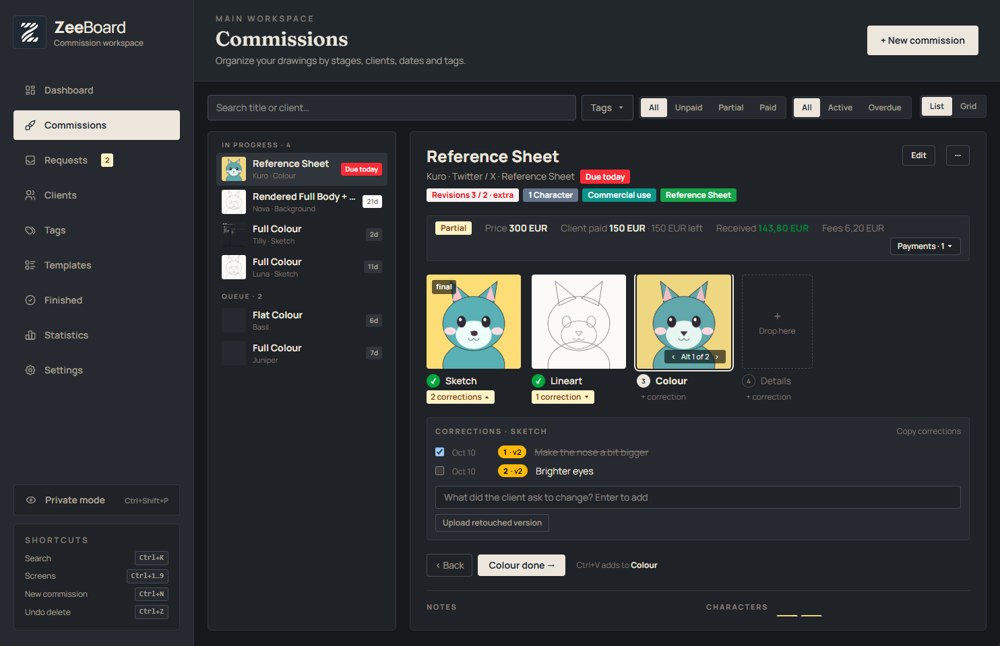

- Every correction counts as **one revision**. The header shows `Revisions used / included`, using the limit set in the template.
- The counter's dot turns amber when you reach the limit and red (**extra**) when you go over it.
- Corrections are dated, and you can delete them.

**Pins on the image.** In focus mode press **+ Correction pin**, click where the change goes, write it and press Enter. Pins are numbered per image and belong to that exact version; click one to read it, mark it as done or remove it. **Esc** leaves pin mode first and then closes the image.

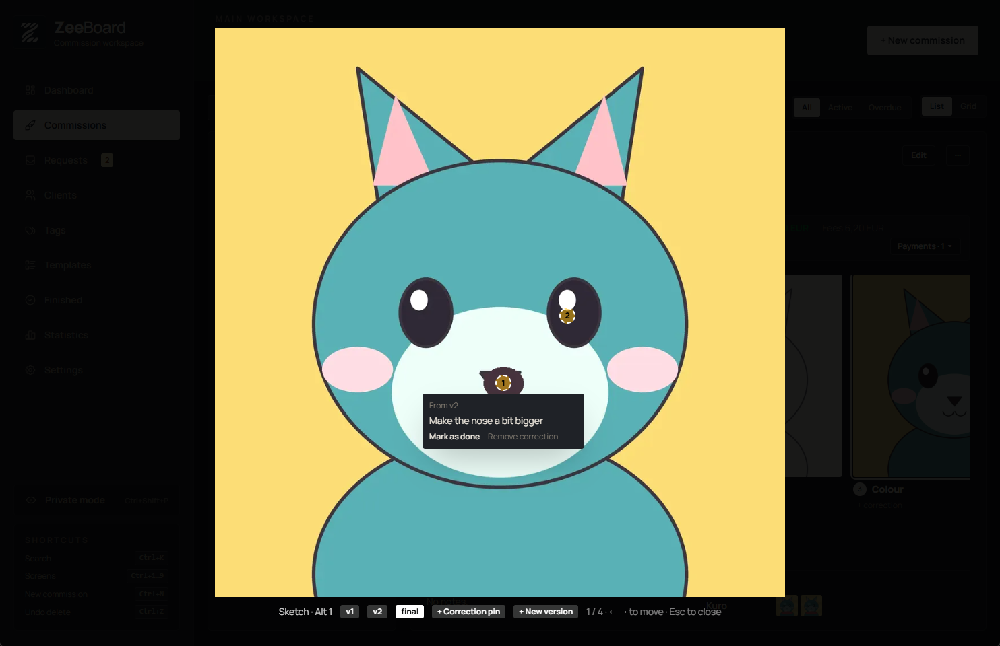

- In the panel, each pinned correction shows its number and version (`2 · v2`); click it to open that image.
- Tick the **box** of a correction when it is dealt with: it is struck through, and the stage button goes from amber to a ✓ when nothing is pending. The revisions counter still counts all of them.
- **Upload retouched version** (in the panel, one per alternative) adds the next version. The **pending pins of the earlier versions appear faded** on the new one, so you can check each change and mark it as done.
- **Copy corrections** copies the pending ones as a numbered list (`1. Make the nose bigger`) to paste to the client.

### Creating and editing a commission

Press **Ctrl+N** or **+ New commission**.

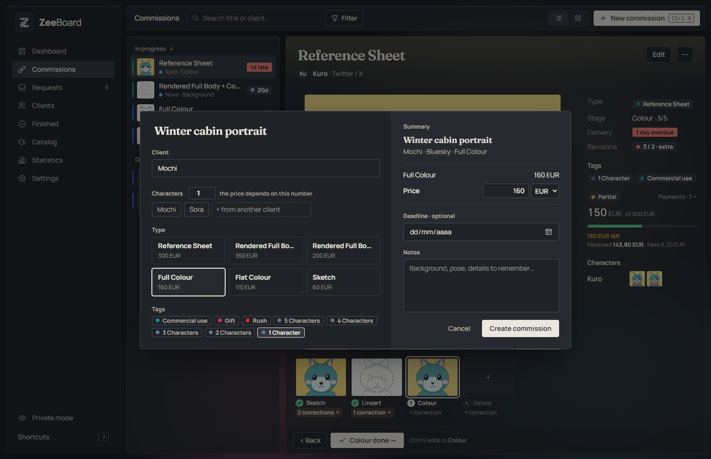

- Pick the **client** (type to search, or write a new name), the **characters** (also from other clients, for collaborations) and the **template**.
- The **Characters** number next to the characters decides the price. It follows the characters you link, but you can raise it when a character has no profile (a collaborator you don't have as a client); it never drops below the ones linked. Requests that came with "2 characters" keep that number.
- The **price** is calculated for you: the template's base price plus a percentage per extra character (50 % by default, adjustable in Settings). You can still change it by hand.
- The **type** comes from the template (and its colour from the Catalog); only the "N Characters" tag is added automatically, and you can add extra tags before saving. The summary on the right shows the price breakdown as you type.
- The template is locked once the commission exists, because its stages and images depend on it.

### Invoice description

**··· → Copy description** copies a short text for the PayPal invoice, such as `Rendered, 2 characters (Ana, Beto) - @YourHandle`, built from the template and the characters.

## Payments

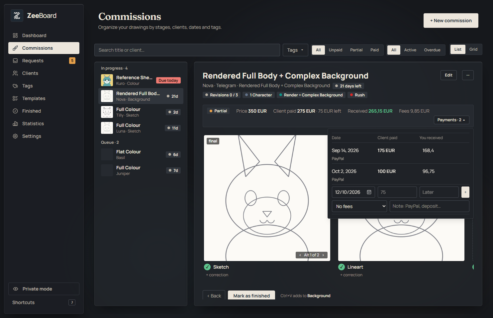

The payments block, in the properties column of the commission, is the single place for money.

- It shows the **status** (Unpaid, Partial, Paid), what the client has **paid** next to the **price**, a progress bar, and what is **left**, what you **received** and the **fees**.
- **Payments** unfolds the list in the same column and the form to add one: the date, what the client paid, and what reached you. Pick a **platform** and "received" is filled with the fee already taken off (for example PayPal's 2.9 % + 0.35).
- You can leave "received" empty and enter it later, when the money arrives. Partial payments (a deposit, then the rest) are supported.
- Platforms and their fees are configured in [Settings](#settings).

## Requests

The inbox for people who want a commission.

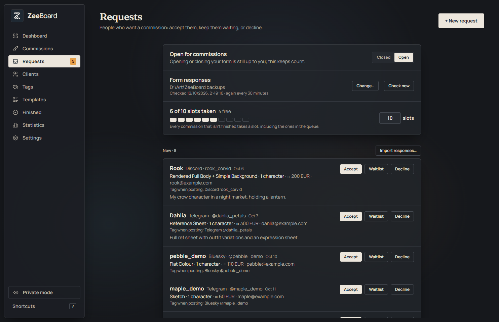

- The **top bar** has **Closed / Open** (you open and close your form yourself) and the **slots**: little squares for how many unfinished commissions you have (queue included) against how many you accept at once, with the total editable.
- The left list groups **New**, **Waitlist** (with a note when you have free slots) and a collapsible **Archive**. A request with no type yet shows "Choose the type…". At the bottom, the state of the **connected form** and a **···** menu (Check now, Change file).
- **Form responses**: ZeeBoard can read the responses of a **Google Form** from a CSV file that a small Google script keeps up to date in your Drive. It checks it when it opens and every 30 minutes, adds the new responses and shows a counter in the menu. You can also **Import** a CSV by hand.
- The open request shows who and when, **what they ask for** (links are clickable) and, beside it, the type, number of characters, an **estimated price**, contact, social account and email.
- The footer has **Accept**, **Waitlist**, **Decline** and **Restore** (and **Open commission** / **Remove from the list** for the archived ones). Accept is disabled until the request has a type; if your slots are full, accepting asks for confirmation.
- Accepting creates, in one step: the **client** (or reuses the one you already have, matched by handle or name), their email and tag account, the **commission** with its price, and the **tags**. It also tries to fetch the client's profile photo in the background.
- **+ New request** adds one by hand, and it goes through exactly the same flow.

## Clients and characters

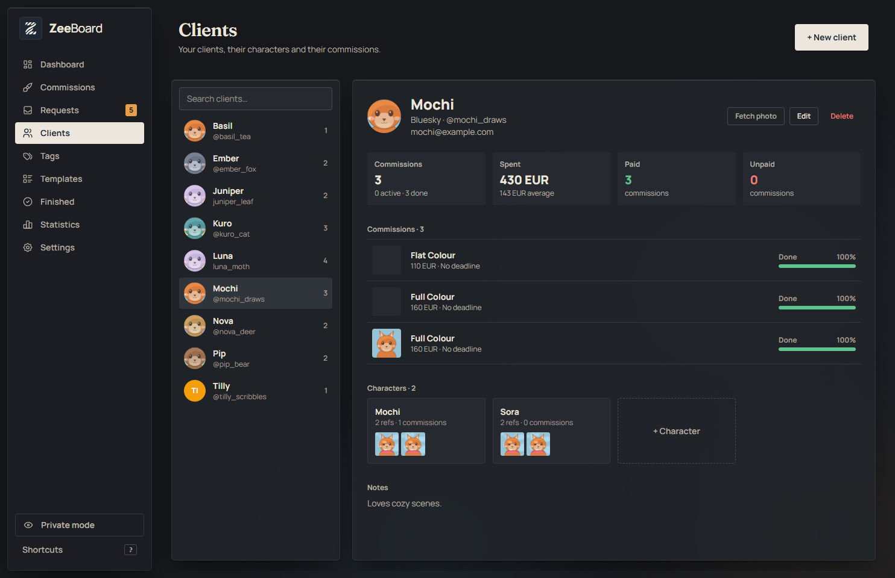

- A client has a name, platform and handle, an **email** (used to match PayPal payments), the **account to tag** when you post their work, and free notes. The header is tinted with the colours of their photo.
- The figures show how much they have **spent** (and the average), how many commissions they have (active and done) and what is **still pending** to be paid. Their commissions are listed below with the colour bar of the type.
- The side column has the **social account**, contact, email and the date they became a client, plus **Notes**, which are saved by themselves when you leave the field.
- The **photo** can be fetched from Bluesky or Telegram (**··· → Fetch photo**: tag account first, then contact account), or set by hand by clicking the avatar, dropping an image on it or pasting with Ctrl+V. Photos are downloaded once and stored on your disk. **Edit** and **··· → Delete client…** are in the header.

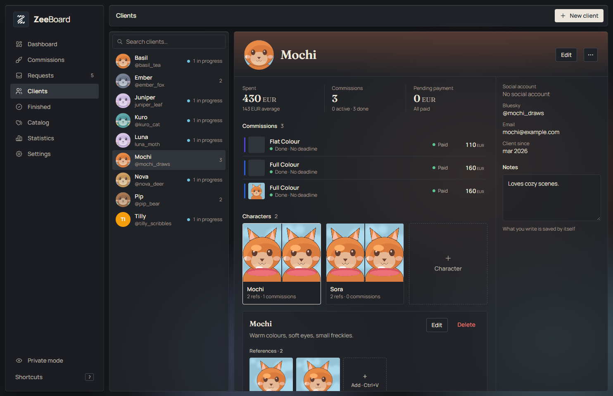

- Each client keeps their **characters** as a gallery, each with notes and **reference images**. A character can be used in commissions of any client.
- Deleting a character also deletes its references and removes it from any commission.

## Catalog: types and tags

One screen with a list on the left (the **commission types** and then the **tags** grouped by category) and an editor on the right.

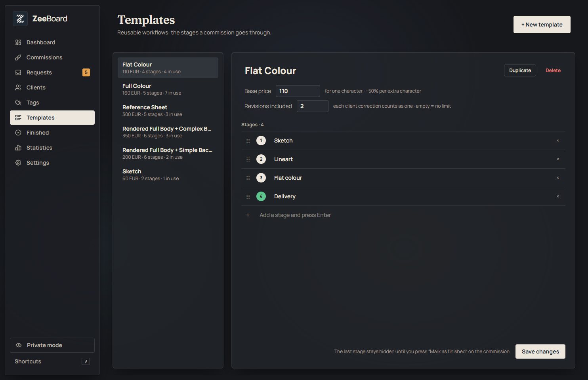

- A **type of commission** is a template plus a **colour**. The template is the list of stages that kind of commission goes through; the colour is the bar and chip every commission of that type shows.
- Each type has a **base price**, a number of **revisions included**, and an ordered list of **stages** you can rename, reorder by dragging, add or remove. The **last stage marks the commission as finished**. Beside the stages you see the commissions in progress of that type and the figures of the delivered ones (how many, average price, average hours, rate per hour).
- A stage that a commission is using cannot be removed, so no commission loses its place or its images. Types in use cannot be deleted, but you can **duplicate** them to make a variation.
- **Tags** are for extras (rush, commercial use, number of characters…), grouped by category with a colour each; the list shows how many commissions use each. A category is created with its first tag.
- Tags filter the commissions list and feed the "most used" panel in the dashboard. The old "Commission Type" tags are kept so nothing is lost, but they are no longer shown on commissions.

## Finished commissions

Everything you have delivered, as a register.

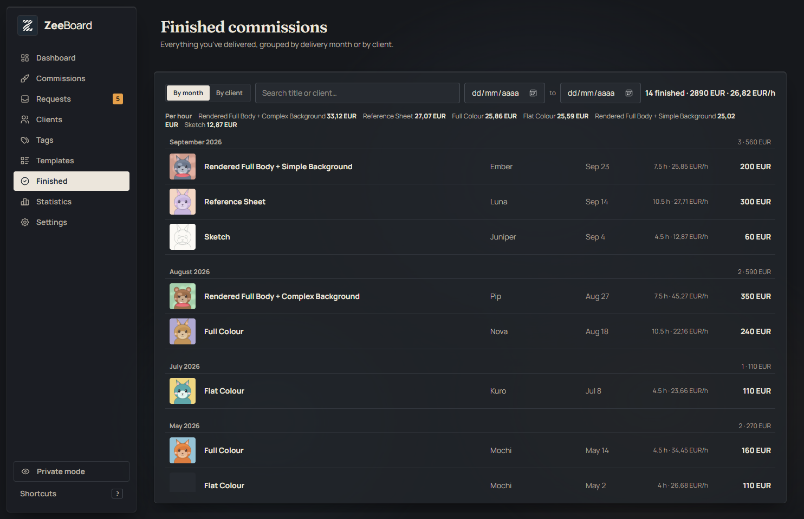

- A gallery grouped by **month** or by **client**, with a sticky header for each group (count and total). Search by title or client and filter by **date range**.
- Each tile shows the image, the title, the amount and the client (or date), hours and rate per hour. The top line has how many you finished, the total and your **rate per hour**, and the rate per type. Click an image to see it large (the background takes its colours); click the text to open the commission.

**Marking a commission as finished.** On the last working stage, the button reads **Mark as finished**: you set the **delivery date**, the **hours spent** (typed by hand), an optional **final image** and **final notes** (a link to the post, how it went…). **Back** reopens it, and **Edit delivery** changes those details later. Hours and delivery date feed the register and [Statistics](#statistics).

## Statistics

How the business is doing, from your payments and your finished commissions.

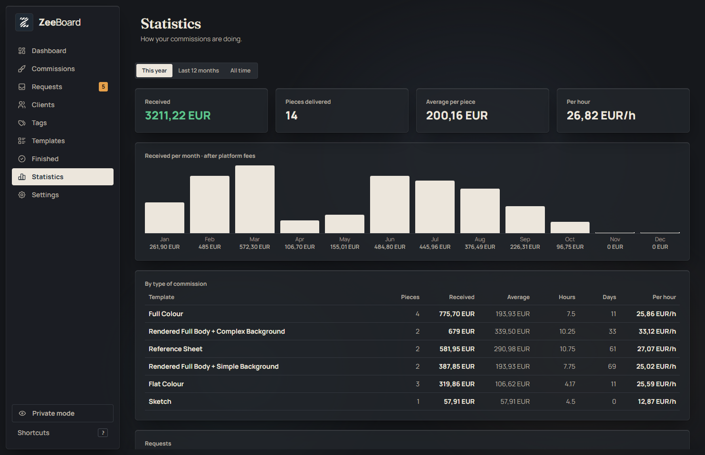

- Choose **This year**, **Last 12 months** or **All time**. The key figures (received, pieces delivered, average per piece, per hour) show the change against the previous period.
- **Received per month** counts money by the day it reached you, net of platform fees. Pieces, averages and hours count by delivery date.
- **By type of commission**: pieces, received, average, hours, days from request to delivery and rate per hour for each template.
- **Requests**: one bar with how many came in and how many were accepted, declined, waiting or unanswered, plus the acceptance rate.
- **Top clients** with the share of income that comes from clients who come back, and the **platform fees** you paid.
- Only commissions in your default currency are counted; currencies are never added together.

## Trash and undo

Nothing is deleted for good at once. Commissions, clients, characters, templates, tags, requests, payments and corrections go to the **trash**.

- The "deleted" message has an **Undo** button, and **Ctrl+Z** (outside a text field) restores the last deleted item.
- **Settings → Trash** lists everything with its date, to restore it or delete it for good. Items are removed after **30 days**.
- Image files are kept while an item is in the trash, so restoring brings its images back.

## Reminders

ZeeBoard watches your commissions and tells you what needs attention, in the dashboard and as **Windows notifications** (each alert is shown once).

- **Delivery**: a few days before the limit and on the day. If a commission has no deadline, the limit is the day you accepted it plus the longest time you promise (60 days by default).
- **Stalled**: no new image, correction, payment or stage change for a number of days (21 by default).
- **Unpaid**: the commission left the first stage of its template (your sketch was approved) and nothing has been paid yet.

Alerts are checked when the app opens and every 30 minutes while it stays open. All the numbers are in [Settings](#settings).

## Importing PayPal payments

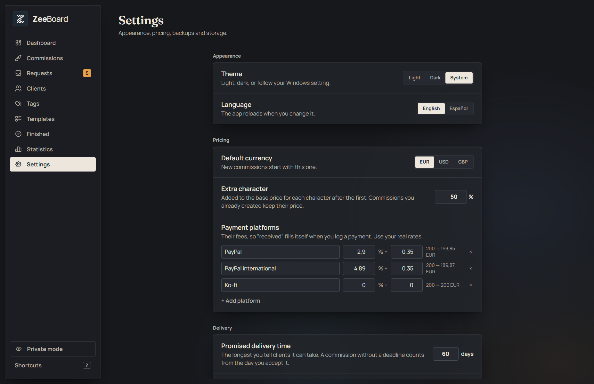

Download your **activity CSV** from PayPal (English or Spanish headers) and choose it in **Settings → Import payments**.

- Each incoming payment is matched with a **client by their email**, and with that client's commission that still has a **balance in the same currency**: first the one that owes exactly that amount, otherwise the oldest.
- You see a **preview** and can change the commission of each payment before importing. Payments without a matching client, refunds and pending ones are skipped.
- Each payment is saved with what the client paid, **what you actually received** (PayPal's net) and its date. The transaction id is stored, so **importing the same file twice never duplicates** anything.
- Settings tells you the date of your last imported payment and from which day to download the next file (two days earlier, so nothing is missed).

## Search and shortcuts

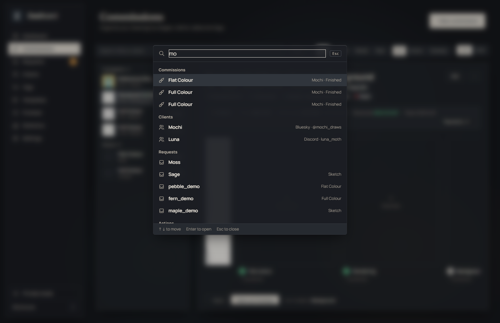

Press **Ctrl+K** anywhere to search commissions (title, client, stage), clients (name, handle, email), requests and screens, and to run **actions**: new commission, new client, toggle private mode, switch language, switch theme, back up now, show the shortcuts. Accents and capital letters are ignored, and every word you type must match.

| Shortcut | What it does |
|---|---|
| `Ctrl+K` | Search and actions |
| `Ctrl+1` … `Ctrl+9` | Go to a screen, in menu order |
| `Ctrl+N` | New commission |
| `Ctrl+Shift+P` | Toggle private mode |
| `Ctrl+V` | Paste an image into the current stage (or the open character) |
| `?` | Show the list of shortcuts |
| `Esc` | Close the panel or dialog |

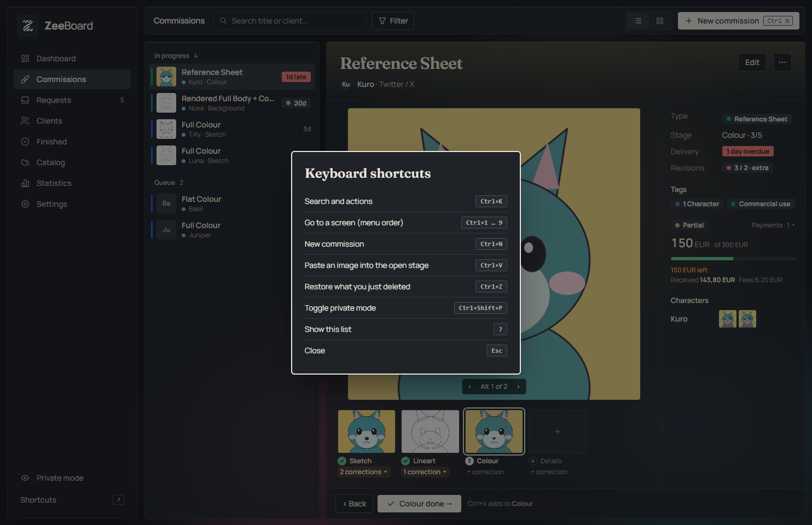

## Private mode

For streaming or screen sharing. **Ctrl+Shift+P** (or the button in the menu) hides **client names and prices** everywhere, and blurs the text fields that can hold them. The setting is remembered, so if you restart the app mid-stream it stays hidden. Exports always contain the real data.

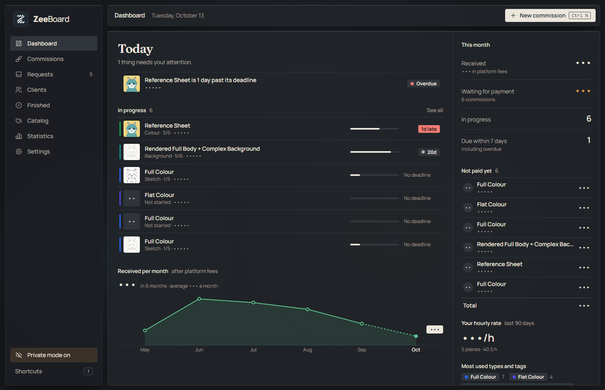

## Receiving images from the iPad

Skip the email: draw on the iPad and send the images straight to a commission stage.

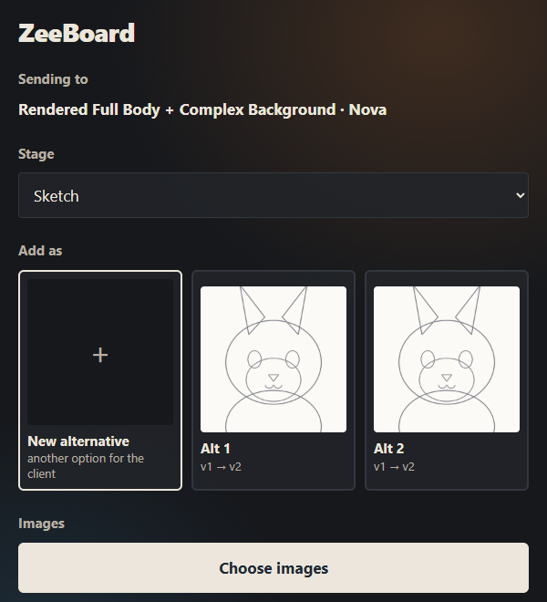

1. In **Settings → iPad** switch **Receive images from the iPad** on. ZeeBoard shows a **QR code** and a link.
2. Open the link on the iPad (scan the QR with the camera, then add the page to the Home Screen if you like). ZeeBoard must be open on the PC.
3. Pick the **commission**, the **stage** (the current one by default) and what the image is: a **new alternative** (default) or a **new version** of one of the stage's alternatives, shown with its thumbnail.
4. Choose the images and send. They go through the same processing as any image and appear in the commission straight away.

- **Same Wi-Fi or not**: on the same network the link works as is. To send from **mobile data** (or any other network), install [Tailscale](https://tailscale.com/download) on the PC and the iPad and sign in with the same account; ZeeBoard detects it and shows the Tailscale address.
- **Safety**: the server exists only while the switch is on, every request needs the secret key in the link, and it only accepts images (up to 200 MB). **New key** invalidates old links, and the link is hidden in [private mode](#private-mode). The first time, Windows asks to allow ZeeBoard through the firewall: allow it on private networks.

## Settings

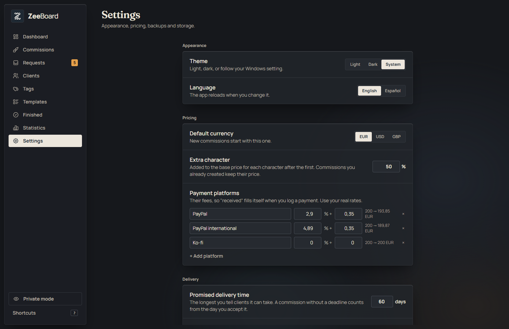

Sections on the left, the chosen one on the right. Everything saves by itself.

- **General**: theme and language.
- **Prices and payments**: default currency (EUR, USD or GBP), the extra-character percentage, and your **payment platforms** with their fixed and percentage fees, with a live example (`200 → 193.85`).
- **Deadlines and alerts**: the longest time you promise, delivery reminders and stalled alerts, each with its own number of days and an on/off switch.
- **iPad**: the [iPad receiver](#receiving-images-from-the-ipad).
- **Backups**, **Data and storage** (PayPal import, CSV export, disk use, unused images) and **Trash**, below.

### Backups

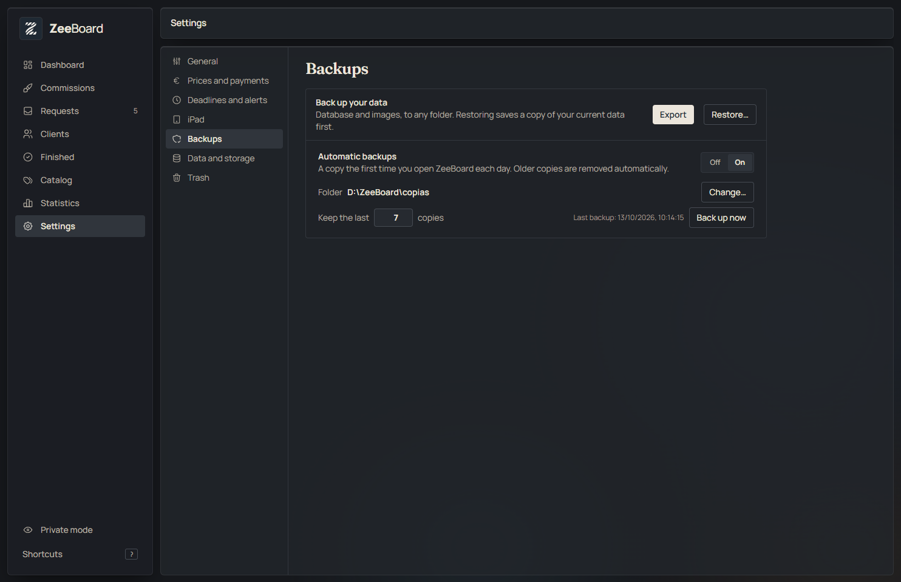

- **Export** saves the database and all images into a dated folder, wherever you choose.
- **Restore** replaces your data with a backup. First it keeps a **safety copy of your current data**, and it never deletes images. The app reloads when it finishes.
- **Automatic backups**: one copy the first time you open ZeeBoard each day, in the folder you choose, keeping only the last N (7 by default). Pointing it at a synced folder (Google Drive, Dropbox…) gives you off-site backups for free.
- **Unused images → Clean up** deletes image files that no commission or character uses any more, after making a full backup first.

### Exporting data

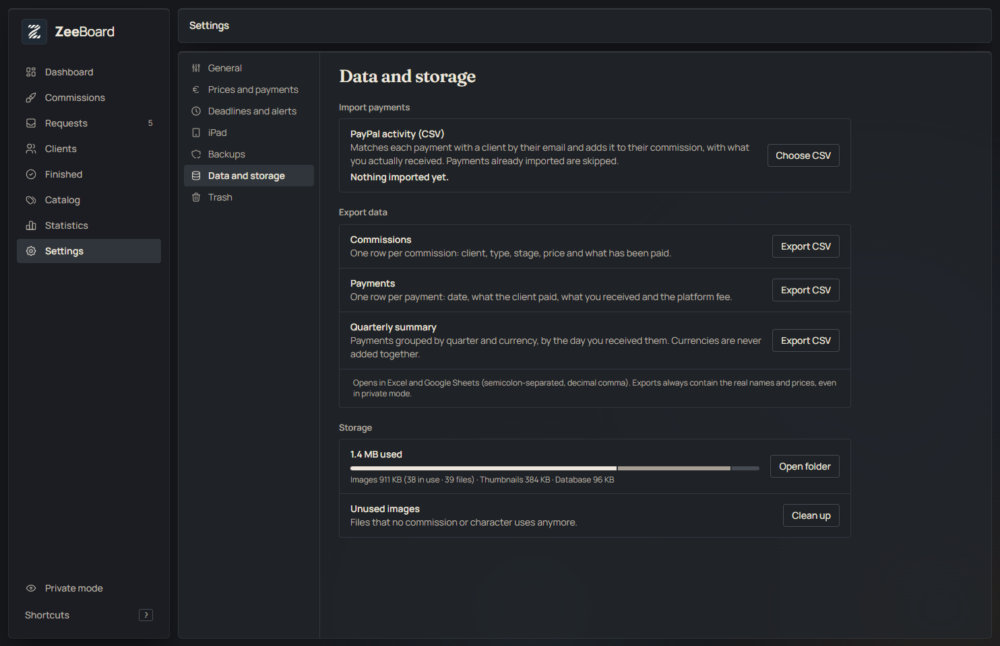

Three CSV exports: **Commissions** (one row each), **Payments** (date, paid, received and fee) and a **Quarterly summary** by quarter and currency (currencies are never added together). They use a semicolon and a decimal comma and include a BOM, so **Excel opens them correctly** in Spanish and English locales. The **Storage** card shows how much space the images, thumbnails and database use.

## Themes and languages

Light, dark, or follow your system:

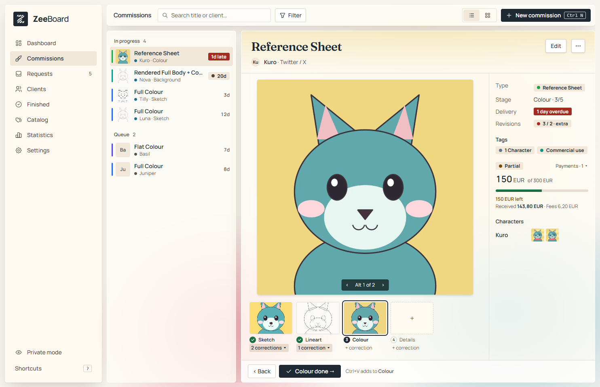

**The look.** Panels are frosted glass over a soft colour background. The colours come from the image you are looking at: the stage image under the cursor, or the one open in focus mode. They fade into the colours of the next image, and the glow drifts to a different place on each screen. Statuses and tags are quiet chips with a coloured dot, so the colour never competes with your artwork.

**Accessibility.** Keyboard focus is always visible, dialogs close with **Esc**, and secondary text keeps at least 4.5:1 contrast. If Windows is set to reduce motion, the background stays still and animations are cut; if it is set to reduce transparency, panels become solid.

The whole app is also available in **Spanish**. Switching the language reloads the app and keeps you on the same screen. Names, notes and anything you type stay as you wrote them.

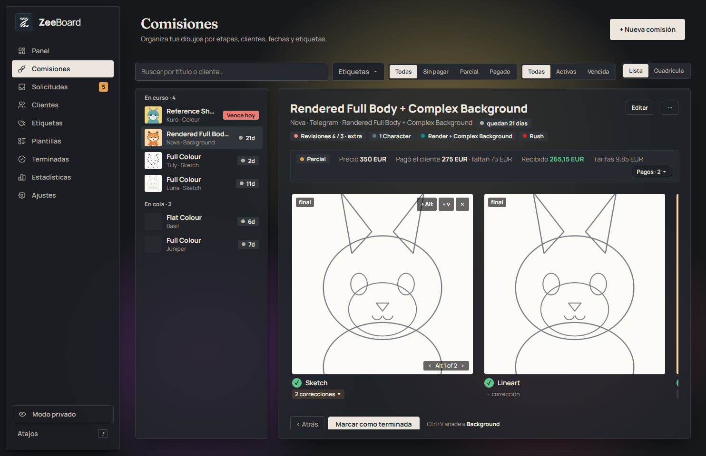

## Privacy and data

- **Everything is stored locally** in `%APPDATA%\com.zeeboard.app\`: `zeeboard.db` (SQLite) and an `images/` folder. Uninstalling does not delete it unless you ask.
- **Images** are processed on your machine: a lightweight WebP copy for viewing and a thumbnail. Your originals are never touched.
- **The only connection ZeeBoard makes to the internet** is the optional *Fetch photo* feature. It runs in the app's Rust side with a **closed list of servers** (Bluesky and Telegram), only over `https`, with time and size limits. Nothing else is sent anywhere.
- The **iPad receiver** is off by default. While its switch is on, ZeeBoard listens on one port of your PC; every request needs the secret key of your link and only images are accepted. ZeeBoard never opens it to the internet itself: to reach it from mobile data you use Tailscale, a private network between your own devices.
- The Google Form connection reads a **local CSV file** (kept up to date by your own Drive for desktop); ZeeBoard never logs in to Google.
- There are no accounts, analytics or telemetry.

## For developers

Requirements: [Node.js](https://nodejs.org), [Rust](https://www.rust-lang.org/tools/install) and the [Tauri prerequisites for Windows](https://tauri.app/start/prerequisites/).

```bash
npm install
npm run tauri dev      # development
npm run tauri build    # builds the installer in src-tauri/target/release/bundle/nsis
```

Quick checks of the business logic (no framework, each prints "ok"):

```bash
npx tsx scripts/check-payments.ts   # also: check-reminders, check-export, check-form-import,
                                    # check-avatars, check-paypal, check-search, check-i18n,
                                    # check-stats, check-trash, check-ipad, check-fresh-db,
                                    # check-permissions, check-ambient
cd src-tauri && cargo test
```

| Part | Technology |
|---|---|
| Desktop shell | [Tauri 2](https://tauri.app) (Rust) |
| Interface | React 19 + TypeScript + Vite |
| Styles | Tailwind CSS 4 |
| Data | SQLite through `tauri-plugin-sql` |
| Images | Processed in Rust (WebP + thumbnails) |
| Icons and type | Tabler Icons, Fraunces and Manrope, bundled with the app |

```
src/
├── App.tsx              menu, shortcuts and navigation
├── pages/               one file per screen
├── components/          shared pieces (search palette, payments, filters…)
└── lib/                 database, images, backups, imports, reminders, i18n…
src-tauri/               Rust side, icons and configuration
scripts/                 quick logic checks
docs/images/             the screenshots in this README
```

Text in the interface is written in English and translated through a dictionary (`src/lib/es.ts`); `scripts/check-i18n.ts` verifies that every text has its translation.

## Roadmap

What has been done and what could come next lives in [ROADMAP.md](ROADMAP.md).

## License

[MIT](LICENSE) © 2026 Alejandro Donate García.
